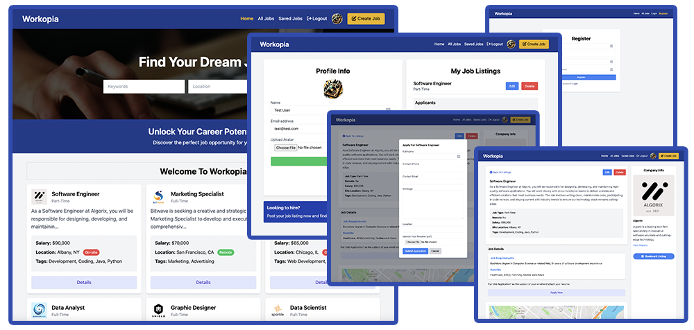

# Workopia (Laravel)

Workopia is a job listing website built with Laravel 12. This repository contains my implementation of the main project from the [Laravel From Scratch course](https://www.traversymedia.com/laravel-from-scratch).



## Features

- Job listing CRUD
- Authentication and authorization policies
- Profile avatar upload
- Blade UI components
- Vite 7 and Tailwind CSS 4 integration
- Bookmarking system
- Job applications and resume uploads
- User dashboard
- Alpine.js interactivity
- Database seeders
- Job search
- Mapbox maps
- Email notifications with Mailtrap
- Job listing pagination

## Requirements

- PHP 8.2 or later
- Composer
- Node.js and npm
- Docker Desktop (with Docker Compose)

## Installation

Install the PHP and JavaScript dependencies:

```bash
composer install
npm install
```

Create your environment file and application key:

```bash
copy .env.example .env
php artisan key:generate
```

Start the PostgreSQL database with Docker Compose:

```bash
docker compose up -d
```

Configure the database connection in `.env`:

```dotenv
DB_CONNECTION=pgsql
DB_HOST=127.0.0.1
DB_PORT=5432
DB_DATABASE=workopia
DB_USERNAME=postgres
DB_PASSWORD=docker
```

The PHP installation must have the `pdo_pgsql` extension enabled before running migrations.

Add your Mapbox API key to `.env`:

```dotenv
MAPBOX_API_KEY=
```

Run the migrations:

```bash
php artisan migrate
```

Optionally, seed the database with sample users, jobs, and bookmarks:

```bash
php artisan db:seed
```

The seeded test account is:

- Email: `test@test.com`
- Password: `12345678`

## Running the Application

Start the Laravel development server:

```bash
php artisan serve
```

In a second terminal, start Vite:

```bash
npm run dev
```

Open http://localhost:8000. To compile production assets, run `npm run build`.

## License

This project is licensed under the [MIT License](https://opensource.org/licenses/MIT).
